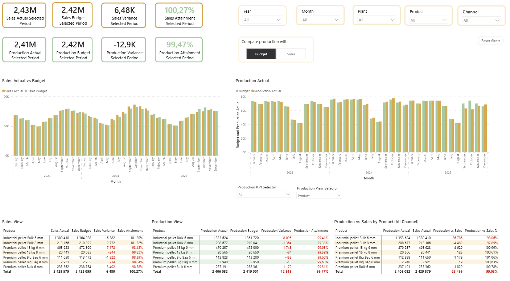
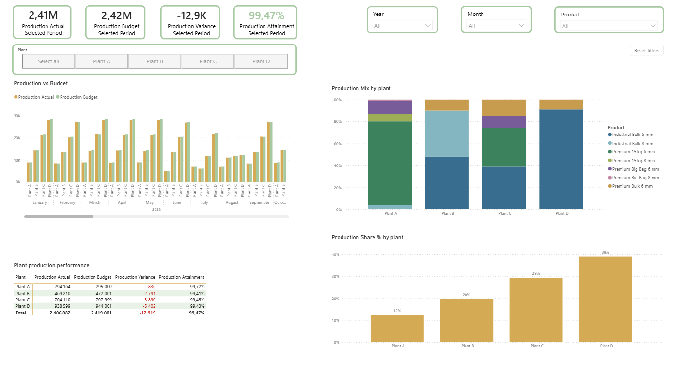
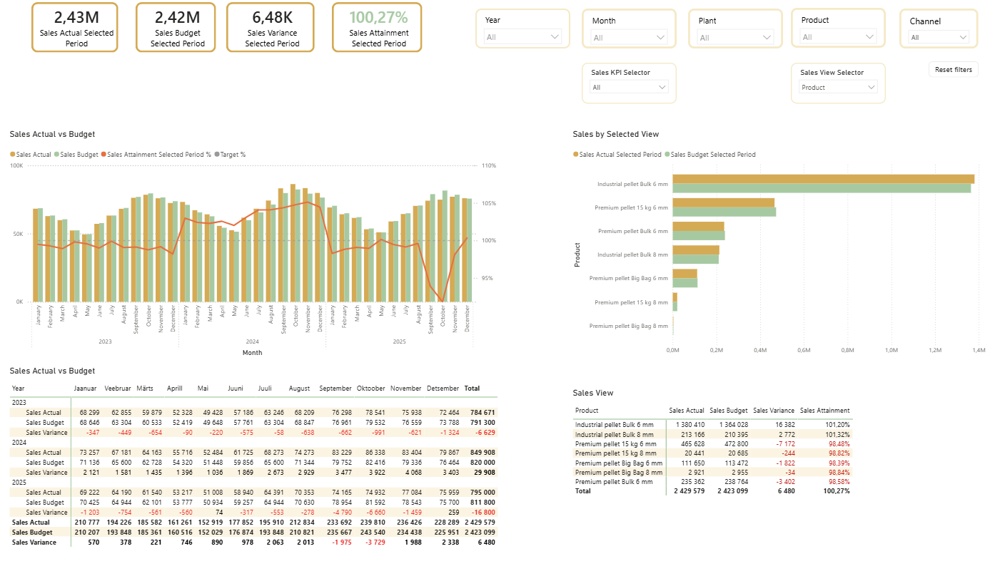

# Pellet Supply Chain Management Dashboard

**A practical management dashboard for a simulated, multi-plant pellet supply chain.**

**Tools:** Power BI · DAX · PostgreSQL · SQL · Python · Git/GitHub  
**Version:** V1 — implemented; quality audit completed; publication preparation in progress\
**Dataset:** Synthetic, Directo-inspired data · 2023–2025

The project brings **sales, production and budget data** into one reporting environment to help management identify deviations, compare plants and products, and examine whether production is aligned with sales.

## Dashboard preview

*V1 Dashboard — management overview of sales and production KPIs, budget variances and production-versus-sales performance. The production-versus-sales comparison uses **all sales channels**, even when a specific sales channel is selected elsewhere on the page. All figures are simulated.*

## The business challenge

A high-level total can look close to budget even when individual plants, products, channels or periods tell a different story. The dashboard is designed around three management questions:

- **Performance:** Are sales and production meeting their budgets?
- **Drivers:** Which periods, plants, products and sales channels explain deviations?
- **Balance:** How does production volume compare with sales volume across all channels?

## What V1 includes

| Report page | Main purpose |
| --- | --- |
| **V1 Dashboard** | Combined sales and production KPIs, budget variances, selectable production views and an all-channel production-versus-sales comparison |
| **Sales Analysis** | Sales trends, **channel-level actual versus budget** comparisons and product-level performance |
| **Production Analysis** | Production against budget and sales, with selectable KPI views |
| **Plant Analysis** | Plant-specific production performance, product mix and share of output |
| **Product Analysis** | Product performance and production-versus-sales relationships |

The report supports interactive year, month, plant and product filters, context-specific **sales-channel filtering**, dynamic selectors and **Reset filters**. An **About** page explains KPI definitions and model context. A hidden technical **QA Validation** page is available in Power BI Desktop editing view for inspecting selected reporting totals; it is hidden in report reading view and is not intended as a standard end-user navigation page.

### Additional analysis views

| Plant Analysis | Sales Analysis |
| --- | --- |
|  |  |
| Explore plant results, production mix and each plant's contribution to total output. | Explore sales trends, **channel-specific actual versus budget** performance and product-level deviations. Sales budgets are allocated by channel and the totals have been cross-checked against PostgreSQL. |

*Click an image to open the full-size screenshot.*

## Data pipeline and model

`Source CSV files → PostgreSQL Bronze → Silver → Gold → Power BI`

The Power BI semantic model uses separate **sales, sales budget, production and production budget fact tables** with shared **date, plant, product and sales-channel dimensions**. SQL scripts support data modelling and quality assurance. Python notebooks provide exploratory analysis and cross-checks of SQL-derived results; **independent end-to-end KPI recalculation in Python is not yet implemented**.

**The dataset is entirely synthetic.** It reflects a Directo-inspired source structure, not actual company transactions or operational results.

## Quality assurance

Data checks are documented, with their scope and limitations stated explicitly:

- **Source → Bronze:** **10/10 tables PASS**, covering **8,007 rows** with no missing or additional rows under the comparison rules.
- **Bronze → Silver → Gold:** sales and production row-count, structural and quantity reconciliations.
- **Gold → Power BI:** selected reported KPI totals checked against database results at the documented precision; sales-channel actuals, budgets and attainment reconciled with PostgreSQL; report filters and reset behaviour tested.

**Interpretation:** A PASS confirms the specific checks performed, not the business accuracy of synthetic data. In the source-to-Bronze comparison, an empty CSV field and PostgreSQL `NULL` are treated as equivalent.

See the [full Source-to-Bronze validation](sql/10_source_to_bronze_full_validation.md), [SQL QA files](sql/) and [quality-assurance notes](docs/07_quality_assurance/).

## About-page measure documentation

The **About** page retrieves measure names, descriptions and DAX expressions from **Power BI semantic-model metadata** instead of maintaining manually copied formulas. The `Model Measures Metadata` calculated table may require recalculation or refresh after measure changes.

## V1 boundaries and next steps

V1 covers **sales, production, budgets and deviations**; it is not yet a complete supply-chain planning system. **Sales budgets are allocated by sales channel**, so channel-level actual-versus-budget comparisons are supported.

Production is **not** allocated to sales channels. On the management overview, the production-versus-sales comparison therefore uses **sales across all channels**, regardless of the channel selected for sales KPIs. This avoids comparing total production with only one channel's sales.

Potential next stages include inventory and coverage, raw-material and BOM planning, capacity constraints, forecast accuracy, OTIF and exception-focused management views.

## Explore the project

- [Power BI report and semantic model](powerbi/)
- [SQL scripts and QA records](sql/)
- [Python notebooks and scripts](python/)
- [Project documentation](docs/)

**Reproducibility note:** This repository is a transparent technical and business portfolio. It is not a fully executable data pipeline.

- **Included:** the architecture description, Gold-layer metadata definitions (`sql/02_gold_documentation.sql`), SQL and Python quality-assurance checks with their recorded results, and the complete Power BI semantic model and report definitions.
- **Not included:** the raw source ZIP archives, which are excluded from Git, and the DDL and ETL scripts that build the Bronze, Silver and Gold layers. The SQL scripts in `sql/` validate existing tables; they do not create them.
- **Consequence:** the full pipeline cannot be rebuilt from this repository alone. Refreshing the report requires a populated local PostgreSQL database; see [Opening and refreshing the report](powerbi/README.md#opening-and-refreshing-the-report).
